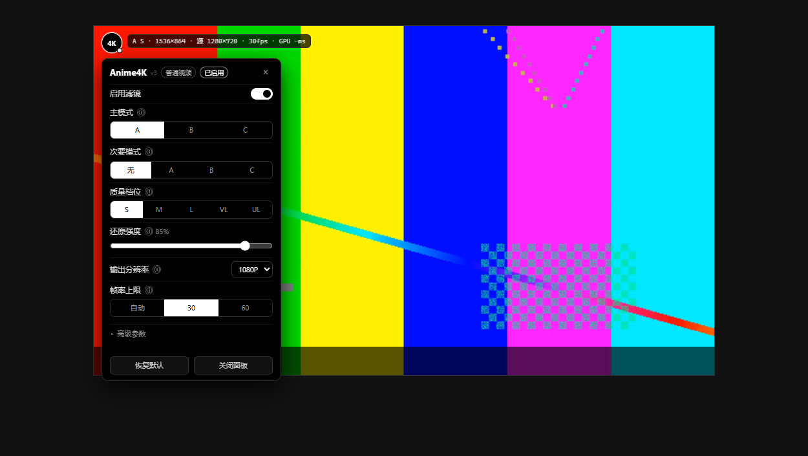

# Bilibili Anime4K（增强版）

给 B 站普通视频与番剧播放器加一层 Anime4K WebGL 实时画质增强。纯前端、无网络请求、单文件 Tampermonkey 脚本。

> 非官方项目，与哔哩哔哩、Anime4K 官方无隶属关系。




## 功能

- **A/B/C 三种还原模式**：分别针对模糊/压缩伪影较多的 1080p、中等伪影的 720p、以及本身干净的高质量源。
- **次要模式**：在 A/B/C 之上再叠一层还原，可组合出 A+A、B+B、C+A 等。
- **S–UL 质量档位**：以内部超采样倍率近似 Anime4K 的 CNN 变体，档位越高细节越干净、GPU 开销越大。
- **分场景配置**：`普通视频` 和 `番剧` 两套独立配置，各自记住开关和全部参数。
- **播放器内设置面板**：左上角悬浮按钮，鼠标移入播放器时与控制栏同步亮起；面板支持 A/B/C、档位、强度、分辨率、帧率、FXAA、锐化、线条灵敏度等实时调整。
- **统计条**：开启后显示模式、内部渲染分辨率、源分辨率、fps 和 GPU 耗时。
- **性能保护**：单帧超预算时自动降低内部渲染分辨率。
- **边界处理**：4K 源自动按原生分辨率输出；HDR/杜比内容默认暂停；WebGL 上下文丢失后自动重建；B 站 SPA 切集/换视频自动重新挂载。

## 安装

前置条件：**Chrome 或 Edge**（Chromium 内核），并安装 [Tampermonkey](https://www.tampermonkey.net/)。

### 一键安装

[点击安装 Bilibili-Anime4K.user.js](https://raw.githubusercontent.com/PYPTsca/Bilibili-Anime4K/main/Bilibili-Anime4K.user.js)

Tampermonkey 会打开安装页，确认即可。之后脚本会通过 `@updateURL` 自动检查更新。

### 手动安装

1. 打开 Tampermonkey 管理面板 → 添加新脚本；
2. 用仓库里的 `Bilibili-Anime4K.user.js` 全文替换编辑器内容；
3. `Ctrl+S` 保存，刷新 B 站页面。

> 如果仓库名或默认分支不是 `Bilibili-Anime4K` / `main`，请同步修改脚本头部的 `@downloadURL`、`@updateURL` 和本文档里的安装链接。

## 使用

- 鼠标移到播放器**左上角**，`4K` 按钮会亮起（与控制栏同步）；点击打开设置面板。
- 点击面板外或按 `Esc` 关闭；面板里的滚轮只滚动面板，不会触发 B 站音量调节。- 番剧页面**默认开启**，普通视频页面**默认关闭**；两套配置互不影响。普通视频开启一次后会一直记住。
- Tampermonkey 菜单里还提供：切换当前页面开关、打开设置面板、重置当前配置。

### 默认配置（极限清晰）

| 参数 | 默认值 |
| --- | --- |
| 主模式 | A |
| 次要模式 | A（即 A+A） |
| 质量档位 | M |
| 还原强度 | 80% |
| 输出分辨率 | 2160P |
| 帧率上限 | 30 |
| FXAA | 关 |
| 放大算法 | Lanczos3 |
| 锐化 | 60% |
| 线条检测灵敏度 | 85% |
| 性能保护 | 关 |
| 显示统计 | 开 |

这套默认值偏重。如果播放不流畅，优先把**质量档位**降到 S/M，或把**输出分辨率**降到 1440P/1080P。

## 参数说明

### 主模式

| 模式 | 优化对象 | 本实现 |
| --- | --- | --- |
| A | 高模糊、压缩伪影较多的 1080p 动画 | thin-lines + 线条检测 + refine，还原力度最强 |
| B | 中等伪影的 720p / 部分 1080p | 同样的管线，强度和检测阈值更克制 |
| C | 本身干净的高质量源 | 跳过线条重建，只做边缘保留降噪 + 放大 |

### 次要模式

`无 / A / B / C`。选 A 表示在第一层之后再跑一层 A 的还原，即 A+A；C 可以作为前置降噪。层数越多越慢。

### 质量档位

| 档位 | 内部超采样倍率 | 说明 |
| --- | --- | --- |
| S | 0.8× | 最快，适合低端核显 |
| M | 1.0× | 平衡 |
| L | 1.2× | 更干净 |
| VL | 1.45× | 高端 GPU |
| UL | 1.75× | 最大质量，最吃显存/算力 |

> 这是**近似实现**：真正的 Anime4K v4 CNN 变体在 WebGL 里无法实时运行，本脚本用内部超采样倍率模拟“越高越清晰、越慢”的梯度。模式本身也是经典 WebGL 管线的近似，不是 v4 的 CNN 推理。

### 其它参数

| 参数 | 说明 |
| --- | --- |
| 还原强度 | 线条还原/细化总幅度。越高线条越细越亮，过高会发灰、振铃。 |
| 输出分辨率 | 自动：按播放器显示尺寸 × DPR，在 1440P–2160P 间取；原生：跟源一致；1080/1440/2160：指定内部目标高度。4K 源在“自动”下直接按原生输出。 |
| 帧率上限 | 自动：屏幕刷新率的一半，限制在 30–60；也可固定 30 或 60。 |
| FXAA | 边缘抗锯齿。开更平滑，关更锐利。 |
| 放大算法 | 双线性最柔和、双三次平衡、Lanczos3 最锐（可能产生白边）。 |
| 锐化 | 后处理 unsharp，用于补偿还原造成的对比度下降。 |
| 线条检测灵敏度 | 越高参与还原的线条越多，效果更明显，也更容易误伤纹理。 |
| 性能保护 | 单帧超预算时自动降低内部渲染分辨率，避免掉帧。 |
| 显示统计 | 在按钮右侧显示模式、分辨率、fps、GPU 耗时。 |
| HDR 内容强制启用 | 检测到 HDR/杜比时默认暂停；强制开启可能偏色。 |

## 性能建议

- 统计条里的 `GPU xx ms` 是单帧渲染耗时：30fps 预算是 33ms，60fps 是 16ms；长期贴近预算就降档。
- 2160P + A+A 是刻意拉满的默认值，中低端 GPU 建议先降到 **M 档 + 1440P**。
- 720P/低码率番剧的提升最明显；1080P 高码率源本身干净，Anime4K 的还原幅度天生较小。
- 觉得画面发灰：降低「还原强度」，把「锐化」提到 30–60，或改用 C 模式。

## 兼容性与已知限制

- 仅支持 **Chrome / Edge**（Chromium 内核）；Firefox、Safari、移动端未适配。
- 仅处理标准 `bpx` 播放器；B 站 DOM 大改时可能需要更新选择器。
- 不处理 DRM/EME 内容；HDR/杜比识别是清晰度文案启发式，可能漏判。
- 画中画、截图等原生能力使用隐藏后的 `<video>`，可能拿到未滤镜画面。
- 小窗/迷你播放器不在支持范围内（脚本会跳过）。

## 隐私

- 脚本**不发起任何网络请求**，不上传视频帧、不收集统计信息。
- 配置仅保存在 Tampermonkey 的 `GM_setValue`（失败时回退 `localStorage`），只存在本机。
- 所有处理都在当前页面的 WebGL 画布内完成。

## 开发与测试

脚本无构建步骤，直接编辑 `Bilibili-Anime4K.user.js`。

本地验收需要 Node 20+、Windows、Edge（测试工具通过 CDP 驱动无头 Edge）：

```powershell
node tools/test-runner.mjs
```

它会启动本地静态服务器、加载 `test/harness.html`、依次验证：

- 三种模式 A/B/C 出帧
- 次要模式与 S/M 档位
- 面板分段点击、tooltip、统计条
- 滚轮拦截、容器缩放重排、按钮命中
- HDR 拦截、双 profile 持久化

截图输出到 `test/out/`，终端打印 PASS/FAIL。Edge 不在默认路径时用环境变量覆盖：

```powershell
$env:EDGE_PATH = "D:\Edge\msedge.exe"
node tools/test-runner.mjs
```

测试视频由 ffmpeg 生成（仓库已带一份 2MB 的 `test/test.mp4`，需要重新生成时）：

```powershell
ffmpeg -y -f lavfi -i "testsrc2=size=1280x720:rate=24:duration=6" ^
  -vf "drawbox=x=0:y=0:w=256:h=144:color=red@1:t=fill" ^
  -c:v libx264 -pix_fmt yuv420p -movflags +faststart test/test.mp4
```

其它调试工具：

- `node tools/inspect-bili.mjs [url]`：无头 Edge 打开 B 站页面并 dump 播放器 DOM；
- `node tools/debug-geom.mjs`：检查画布/播放器几何与重排结果。

## 项目结构

```text
Bilibili-Anime4K.user.js   # 单文件用户脚本
docs/                      # README 截图
test/                      # 本地验收页、服务器、测试视频
tools/                     # CDP 驱动与测试 runner（Windows + Edge）
```

## 致谢

- [bloc97/Anime4K](https://github.com/bloc97/Anime4K)：算法与 GLSL 管线（MIT）
- [NeuroWhAI](https://github.com/NeuroWhAI)：Anime4K WebGL 实现
- [net2cn/Bilibili_Anime4K](https://github.com/net2cn/Bilibili_Anime4K)：B 站用户脚本基线（MIT）
- Tampermonkey

## License

[MIT](LICENSE)。保留 Anime4K、net2cn 与本项目作者的版权声明。

## 免责声明

本项目为非官方增强工具，与哔哩哔哩及 Anime4K 官方无隶属关系。仅对浏览器内已渲染画面做前端处理，不下载、不破解、不绕过付费或 DRM。使用产生的画质、性能与账号风险由使用者自行承担，请遵守 B 站服务条款及所在地法律。
